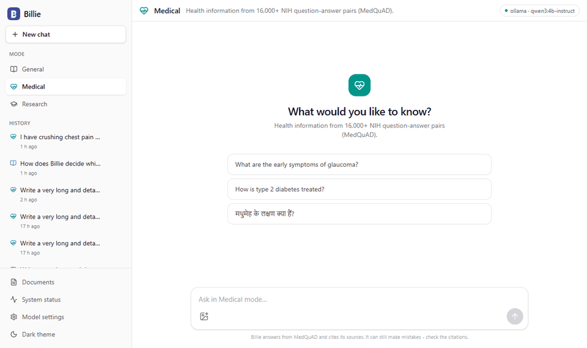
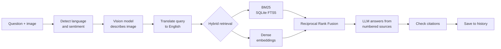

# Billie

**A local-first, retrieval-augmented AI assistant that answers from documents and cites every claim.** Billie searches ~1 million documents with hybrid BM25 + semantic retrieval, streams answers from a local LLM (or any cloud model you plug in), reads images, and replies in the user's language.



| Mode | Corpus | What you can ask |
|---|---|---|
| **General** | Billie's docs + your uploaded PDFs / Markdown | "How does Billie decide which documents to use?" |
| **Medical** | MedQuAD: 16,407 NIH question-answer pairs | "What are the early symptoms of glaucoma?" · "मधुमेह के लक्षण क्या हैं?" |
| **Research** | 980,539 computer-science papers from arXiv | "Compare approaches to reducing hallucination in RAG" |

## Highlights

- **Hybrid retrieval.** BM25 through SQLite FTS5 (searches 980k papers on disk in ~0.4 s) plus dense cosine search over multilingual embeddings, fused with Reciprocal Rank Fusion. Degrades gracefully to BM25 if the embedding model is down.
- **Grounded, cited answers.** Sources are numbered in the prompt; every `[n]` in the answer is checked. The UI marks answers as grounded, ungrounded (cites a source that doesn't exist) or abstained ("not in the documents").
- **Any LLM, switchable at runtime.** Local Ollama by default (free, offline). Anthropic Claude (official SDK), OpenAI, Gemini, Groq or any OpenAI-compatible server can be added from the Settings panel with your own API key.
- **Multimodal.** Attach a photo or screenshot; a local vision model (gemma3:4b) transcribes it and extracts search terms that drive retrieval.
- **Multilingual.** Language detection by script rules, romanised-Hindi ("Hinglish") detection and py3langid. Non-English questions get an English search query, and the answer comes back in the user's language.
- **Sentiment-aware.** A softmax classifier trained on multilingual sentiment data, using the same embedding model as search. Worried or frustrated users get a gentler, clearer answer.
- **Medical safety net.** A deterministic detector (English, Hindi, Spanish) shows an emergency banner with phone numbers or crisis helplines for chest pain, stroke signs, overdose or self-harm, whatever the model writes. It caught a real overdose question in the benchmark set.
- **Fast where it can be on a CPU.** Repeated questions come from an answer cache in ~0.1 s; models are pre-loaded at startup; duplicate passages are removed so every source slot adds information; **Stop** really stops the local model.
- **Feedback loop.** 👍/👎 on every answer (a 👎 also evicts it from the cache), regenerate, edit-and-resend, and conversation deep links.
- **Production habits.** Streaming SSE API, SQLite conversation history, structured JSON logs with request IDs, Prometheus metrics, rate limiting, CSP headers, fail-closed auth in production, validated uploads, a prompt-injection guard, atomic and resumable index builds, Docker, and CI with lint, type checks and tests.

## Quick start (Windows, macOS, Linux)

Prerequisites: Python 3.12, Node 20+, and [Ollama](https://ollama.com).

```bash
# 1. Pull the local models (~6 GB, once)
ollama pull qwen3:4b-instruct      # chat
ollama pull gemma3:4b              # image understanding
ollama pull embeddinggemma         # multilingual embeddings

# 2. Start everything (installs dependencies on first run)
./scripts/dev.sh                   # Windows: .\scripts\dev.ps1
```

Open **http://127.0.0.1:5173**. The API and its interactive docs are at http://127.0.0.1:8000/docs.

Billie works immediately with small bundled samples. To index the full corpora (see [`datasets/README.md`](datasets/README.md) for downloads):

```bash
cd backend
python -m billie.ingest medquad      # ~5 s text index + ~35 min embeddings on a laptop CPU
python -m billie.ingest arxiv        # ~2 min to index 980k papers + embeddings for the newest 50k
python -m billie.ingest status
```

Embedding runs checkpoint as they go. If interrupted, rerun with `--embed-only` and they continue where they stopped.

### Docker

```bash
docker compose up --build            # http://localhost:8000 (Ollama runs as a service and pulls the models)
```

## How it works



Each stage streams a status event to the UI, so a CPU-only laptop still feels responsive. Design decisions, latency measurements and trade-offs are in [`docs/ARCHITECTURE.md`](docs/ARCHITECTURE.md).

## Evaluation

### Medical retrieval on real consumer questions

Queries are the [TREC 2017 LiveQA Medical](https://github.com/abachaa/LiveQA_MedicalTask_TREC2017) test questions: real messages people sent to the U.S. National Library of Medicine, typos included. Relevance comes from the MedQuAD authors' [human judgments](https://github.com/abachaa/MedQuAD) (1-Incorrect … 4-Excellent). The evaluation covers the **39 questions** that have an answer graded 3 or 4 in Billie's index. Three MedlinePlus subsets ship without answers for copyright reasons, so the remaining questions can't be scored fairly. Unjudged answers count as non-relevant, so absolute numbers are conservative.

| Query text | Retriever | nDCG@10 | Recall@10 | MRR@10 | Success@5 |
|---|---|---|---|---|---|
| Original consumer message | BM25 | 0.309 | 0.404 | 0.339 | 0.487 |
| | Dense (embeddinggemma) | **0.453** | **0.656** | **0.424** | 0.564 |
| | **Hybrid (RRF)** | **0.453** | 0.565 | 0.416 | **0.615** |
| NIST paraphrase | BM25 | 0.423 | 0.559 | 0.434 | 0.564 |
| | Dense (embeddinggemma) | 0.471 | 0.712 | 0.469 | 0.744 |
| | **Hybrid (RRF)** | **0.537** | **0.743** | **0.514** | **0.795** |

What this shows:
- **Semantic search matters most for real, messy questions.** On the original messages, nDCG@10 rises 47% over BM25 alone (0.309 → 0.453). People describe symptoms in their own words, not in MedQuAD's vocabulary.
- **Hybrid is the most consistent.** It's best or tied on every metric except recall@10 for the original messages, where dense alone retrieves more relevant answers. A tuned fusion weight might close that gap. It isn't tuned here, because 39 test questions are too few to tune on without overfitting.
- **Clean questions help every retriever,** but the ordering holds: hybrid > dense > BM25.

Dense search covers the first chunk of every MedQuAD answer (16,407 vectors); BM25 covers all 27,582 passages.

**Latency** (retrieval only, laptop CPU, including the query embedding): BM25 p50 12–18 ms; hybrid p50 55–68 ms, p95 81–178 ms. Over the 980k-paper arXiv index, BM25 takes ~0.3–0.6 s.

Reproduce with `python -m evals.retrieval_liveqa` (per-query output in [`docs/evaluation/retrieval`](docs/evaluation/retrieval)).

### Answer quality, end to end

The same 39 questions run through the full live pipeline (`python -m evals.answer_quality`). Every answer sentence that carries a citation is checked against the passage it cites by an LLM judge. The judge is the same local model, so 8 verdicts were spot-checked by hand: 7/8 agreed, and the miss was lenient.

| | Prompt v1 | Prompt v2 (stricter citation rules) | **v1 + citation repair (shipped)** |
|---|---|---|---|
| Grounded / abstained / ungrounded | 72% / 28% / 0% | 77% / 23% / 0% | 77% / 23% / 0% |
| Uncited factual sentences | 57 | 73 ❌ | **46** |
| Cited sentences | 70 | 59 | **81** |
| Cited sentences supported by their source | 85.7% | 85.6% | 84% (model) · **93.8% (automatic, n=8)** |
| Similarity to NLM expert answers (top-passage baseline: 0.59) | 0.67 | 0.67 | 0.675 |

- **Stricter prompt wording made the small model cite *less*.** It was measured, then reverted.
- **Citation repair** links uncited sentences to their source by embedding similarity. The threshold (0.60) was calibrated for ~89% precision on judged pairs; the 8 automatic citations were supported 94% of the time. Sentences that can't be matched are flagged in the UI instead of hidden.
- Generated answers are closer to the expert answers than the best retrieved passage is, in 80% of questions.

### Stress test: 100 questions across every mode

`python -m evals.stress_test` sends 96 questions (General, Medical, Research, follow-ups, images, Hindi / Hinglish / Bengali / Spanish / French, emergencies, out-of-scope, prompt injection, gibberish) plus 4 cache repeats through the live pipeline. Each case states the expected behaviour, and every answer was also read by hand.

- **96/100 passed** on the local 4B model. The 4 failures (two missed emergency phrasings, one answer from memory with no evidence, one misdetected Spanish question) were fixed and re-tested.
- English answers were accurate and cited; refusals were correct (including a drug-synthesis request and a personal insulin-dose question).
- Non-English answers from the small local model had word-level errors; the cloud model (Groq) writes fluent Hindi and Hinglish, so the demo uses it.
- Latency: local model mean 26 s (generation-bound at ~9 tokens/s); Groq + Gemini 1–3 s for text and 3–7 s for images; cached repeats 0.1 s.

Details: [`docs/evaluation/stress_test`](docs/evaluation/stress_test).

### Sentiment

A 3-class softmax head on `embeddinggemma` sentence embeddings, trained with NumPy on 800 tweets per language from `cardiffnlp/tweet_sentiment_multilingual`. Scores are on the official held-out test split (870 tweets per language):

| Language | Accuracy | Macro-F1 | Word-list baseline (acc / F1) |
|---|---|---|---|
| English | 0.664 | 0.641 | 0.440 / 0.373 |
| Hindi | 0.533 | 0.530 | 0.372 / 0.263 |
| Spanish | 0.592 | 0.534 | 0.333 / 0.171 |
| French | 0.608 | 0.590 | 0.337 / 0.174 |
| German | 0.706 | 0.701 | 0.340 / 0.193 |
| Italian | 0.692 | 0.692 | 0.333 / 0.167 |
| Portuguese | 0.644 | 0.632 | 0.337 / 0.174 |
| Arabic | 0.647 | 0.647 | 0.335 / 0.169 |
| **All (6,960)** | **0.636** | **0.632** | ~0.35 |

The classifier adds one ~30 ms embedding call and no extra model download. On the original project's 10 hand-written support messages, the word list scores 8/10 and the classifier 7/10. That set is tiny and was written alongside the word list, so it says little either way. The trained head is kept as the default because it generalises across languages, and the word list remains the offline fallback. Reproduce with `python -m evals.train_sentiment --per-lang 800`.

### Tests

- **Backend:** 141 pytest tests, offline, in ~12 s. They cover BM25/RRF math, resumable embedding, LLM providers via mocked HTTP, the full chat pipeline with a scripted LLM, the API, security and language detection.
- **Frontend:** 13 Vitest tests (SSE parsing, citation rendering, the streaming chat hook, regenerate, feedback) and 4 Playwright end-to-end tests in Microsoft Edge against the live stack (cited answer, emergency banner + Stop, dialogs).
- **Static checks:** `ruff`, `ruff format`, `mypy` and `tsc` are all clean, and CI runs them on every push.

## Project layout

```
backend/
  src/billie/
    api/          FastAPI app, SSE streaming, auth, rate limiting, metrics
    chat/         pipeline (analyse → retrieve → generate → verify), prompts
    retrieval/    SQLite FTS5 index, embeddings, hybrid RRF retriever, chunking
    corpora/      knowledge base / MedQuAD / arXiv loaders, index service
    llm/          provider protocol + Ollama, OpenAI-compatible, Anthropic, runtime settings
    nlp/          language detection, sentiment probe, medical entities, concepts
    ingest.py     index-building CLI
  evals/          retrieval benchmark (LiveQA x MedQuAD), sentiment training/evaluation
  tests/
frontend/         React + TypeScript + Tailwind UI
knowledge/        General-mode documents
datasets/         samples (tracked); full MedQuAD / arXiv (downloaded)
docs/             architecture, evaluation results, archived audit notes
```

## Configuration

Everything has a working default. See [`.env.example`](.env.example) for the full list. The settings that matter most:

| Variable | Default | Purpose |
|---|---|---|
| `BILLIE_ENV` | `development` | `production` refuses to start without API/admin keys |
| `BILLIE_LLM_MODEL` | `qwen3:4b-instruct` | Initial chat model (changeable in the UI) |
| `BILLIE_VISION_MODEL` | `gemma3:4b` | Reads images when the chat model is text-only |
| `BILLIE_EMBED_MODEL` | `embeddinggemma` | Semantic search; `off` = keyword search only |
| `ANTHROPIC_API_KEY`, `OPENAI_API_KEY`, … | – | Optional cloud providers (or paste keys in Settings) |

## Limitations

- Speed depends on the model: with the default cloud setup (Groq for text, Gemini for images) a cited answer takes ~1–3 s and an image question ~3–7 s. On the local fallback (CPU-only, 4B model) answers take ~15–35 s, because decoding is memory-bandwidth bound (~9 tokens/s); repeats are instant from the cache.
- MedQuAD is U.S.-centric and partly dated, and drug answers were removed upstream. Medical mode is educational, not medical advice.
- Dense search covers the newest 50k arXiv papers (CPU time; `--embed-limit` grows it incrementally); BM25 covers all 980k.
- Citation checking confirms that cited sources exist and were provided, not that every sentence is entailed by its source.

## Acknowledgements

MedQuAD (Ben Abacha & Demner-Fushman, *BMC Bioinformatics* 2019, CC BY 4.0) · TREC 2017 LiveQA Medical · arXiv metadata via Kaggle (CC0) · `cardiffnlp/tweet_sentiment_multilingual` · Ollama, Qwen, Gemma.


