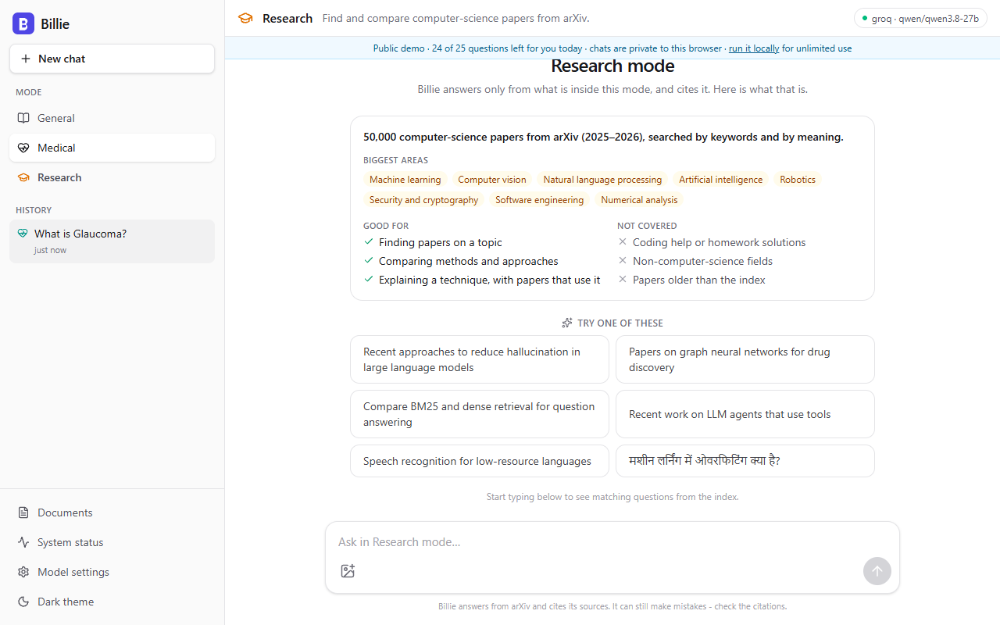
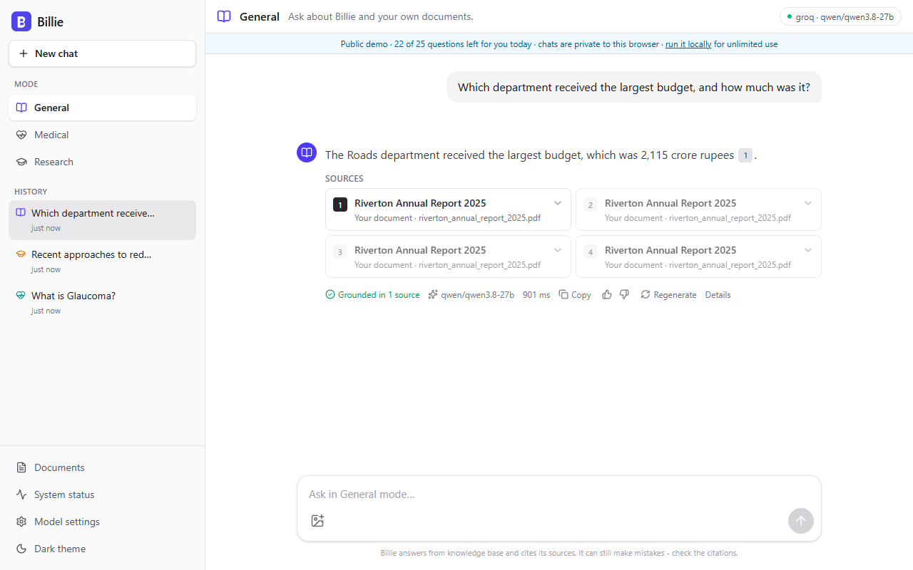
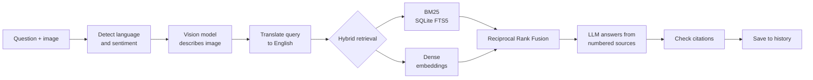
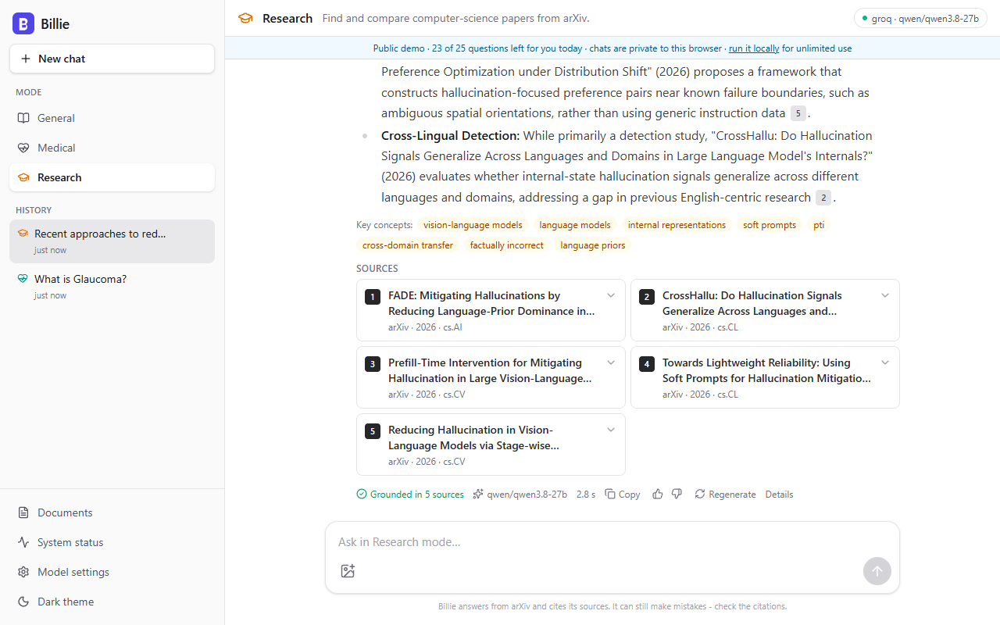

# Billie

**A local-first, retrieval-augmented AI assistant that answers from documents and cites every claim.** Billie searches ~1 million documents with hybrid BM25 + semantic retrieval, streams answers from free cloud models (Groq for text, Gemini for images) or fully offline local models, falling back automatically, reads images, and replies in the user's language.

**Live demo: [billie.kindwater-b6a0b879.uaenorth.azurecontainerapps.io](https://billie.kindwater-b6a0b879.uaenorth.azurecontainerapps.io)**. Each visitor gets a daily question limit, and chats are private to the browser. If nobody has used it recently, the first visit takes about a minute while the server starts.


| Mode | Corpus | What you can ask |
|---|---|---|
| **General** | Billie's docs + your uploaded PDFs / Markdown | "How does Billie decide which documents to use?" |
| **Medical** | MedQuAD: 16,407 NIH question-answer pairs | "What are the early symptoms of glaucoma?" · "मधुमेह के लक्षण क्या हैं?" |
| **Research** | 980,539 computer-science papers from arXiv | "Compare approaches to reducing hallucination in RAG" |

## Highlights

- **Hybrid retrieval.** BM25 through SQLite FTS5 (searches 980k papers on disk in ~0.4 s) plus dense cosine search over multilingual embeddings, fused with Reciprocal Rank Fusion. Degrades gracefully to BM25 if the embedding model is down.
- **Grounded, cited answers.** Sources are numbered in the prompt; every `[n]` in the answer is checked. The UI marks answers as grounded, ungrounded (cites a source that doesn't exist) or abstained ("not in the documents").
- **Fast cloud answers, offline fallback.** The recommended setup uses Groq (`qwen/qwen3.8-27b`) for text and Gemini 3.5 Flash-Lite for images, both on free tiers: ~1–3 s per answer. If the cloud fails or hits a rate limit, the local Ollama model answers instead. Anthropic Claude, OpenAI, OpenRouter or any OpenAI-compatible server can be switched in from the Settings panel.
- **Shows what it knows.** Each mode opens with a coverage card computed from its index. Medical, for example, lists 16,407 NIH answers on 5,126 topics, the kinds of questions, the sources, and what isn't covered. Examples are taken from questions that passed the stress test, and typing suggests real questions or paper titles from the index. When Billie can't answer, it points to a better-suited mode or the closest topics it does have, instead of leaving a dead end.
- **Public demo mode.** `BILLIE_DEMO=1` gives every visitor private chats and caps questions per visitor and per day, so a public link can't drain a free model quota.
- **Ask about your own documents, privately.** On the demo, a visitor can upload up to 3 files (PDF, Markdown or text) and ask about them in General mode alongside Billie's docs.
  - Each visitor gets a separate small index that nobody else can search.
  - Answers that use those files are never cached, because the cache is shared between visitors.
  - Everything is deleted an hour after last use.
- **Multimodal.** Attach a photo or screenshot; a vision model (Gemini, or local gemma3:4b offline) reads it and extracts search terms that drive retrieval.
- **Multilingual.** Language detection by script rules, romanised-Hindi ("Hinglish") detection and py3langid. Non-English questions get an English search query, and the answer comes back in the user's language.
- **Sentiment-aware.** A softmax classifier trained on multilingual sentiment data, using the same embedding model as search. Worried or frustrated users get a gentler, clearer answer.
- **Medical safety net.** A deterministic detector (English, Hindi, Spanish) shows an emergency banner with phone numbers or crisis helplines for chest pain, stroke signs, overdose or self-harm, whatever the model writes. It caught a real overdose question in the benchmark set.
- **Fast where it can be on a CPU.** Repeated questions come from an answer cache in ~0.1 s; models are pre-loaded at startup; duplicate passages are removed so every source slot adds information; **Stop** really stops the local model.
- **Feedback loop.** 👍/👎 on every answer (a 👎 also evicts it from the cache), regenerate, edit-and-resend, and conversation deep links.
- **Production habits.** Streaming SSE API, SQLite conversation history, structured JSON logs with request IDs, Prometheus metrics, rate limiting, CSP headers, fail-closed auth in production, validated uploads, a prompt-injection guard, atomic and resumable index builds, Docker, and CI with lint, type checks and tests.

## Screenshots

| Each mode says what it contains | Ask about your own document (private, 1 hour) |
|---|---|
|  |  |

## Quick start (Windows, macOS, Linux)

Prerequisites: Python 3.12, Node 20+, and [Ollama](https://ollama.com).

```bash
# 1. Pull the local models (~6 GB, once)
ollama pull qwen3:4b-instruct      # chat
ollama pull gemma3:4b              # image understanding
ollama pull embeddinggemma         # multilingual embeddings

# 2. Start everything (installs dependencies on first run)
./scripts/dev.sh                   # Windows: .\scripts\dev.ps1
```

Open **http://127.0.0.1:5173**. The API and its interactive docs are at http://127.0.0.1:8000/docs.

This runs fully offline. For ~10× faster answers, open **Settings** and add free API keys: a [Groq](https://console.groq.com/keys) key for text and a [Gemini](https://aistudio.google.com/apikey) key for images. Billie keeps the local models as automatic fallback. Keys are stored only in the git-ignored `data/` folder.

Billie works immediately with small bundled samples. To index the full corpora (see [`datasets/README.md`](datasets/README.md) for downloads):

```bash
cd backend
python -m billie.ingest medquad      # ~5 s text index + ~35 min embeddings on a laptop CPU
python -m billie.ingest arxiv        # ~2 min to index 980k papers + embeddings for the newest 50k
python -m billie.ingest status
```

Embedding runs checkpoint as they go. If interrupted, rerun with `--embed-only` and they continue where they stopped.

### Docker

```bash
docker compose up --build            # http://localhost:8000 (Ollama runs as a service and pulls the models)
```

### Public demo deployment

The live demo runs as one container on **Azure Container Apps**:

- Text answers come from Groq and images are read by Gemini; the API keys are stored as Azure secrets.
- Embeddings run inside the container with Ollama, because the indexes were built with that exact model.
- Demo mode is on: chats are private to each visitor, and questions are capped per visitor and per day.
- It scales to zero when idle, so it costs nothing between visits and stays within the student credit.

| Piece | Where |
|---|---|
| Image recipe | [`deploy/Dockerfile`](deploy/Dockerfile): React build → Ollama + `embeddinggemma` → Python API on port 7860 (the same image also runs as a Hugging Face Docker Space; see [`deploy/README.md`](deploy/README.md)) |
| Search indexes | `python -m billie.ingest bundle` → MedQuAD + the 50k embedded arXiv papers (2.6 GB → ~300 MB), attached to a GitHub release |
| Image build | [`.github/workflows/build-image.yml`](.github/workflows/build-image.yml), run manually; pushes to Azure Container Registry. Azure's own builder is disabled on student subscriptions, so GitHub Actions builds it |
| Hosting | Azure Container Apps in UAE North, the closest region allowed for Azure for Students accounts. 2 vCPU / 4 GB while running; switched off when idle (0–1 copies); public HTTPS link |
| Cost | ≈ $5/month for the image registry. Running it stays within Azure's free monthly allowance at demo traffic. Both come out of the Azure for Students credit (no card). An email alert fires if monthly spending passes $10 |

Measured on the live deployment: text answers 1.0–2.6 s, image questions ~6 s. The first request after idle includes a cold start.

## How it works



Each stage streams a status event to the UI, so a CPU-only laptop still feels responsive. Design decisions, latency measurements and trade-offs are in [`docs/ARCHITECTURE.md`](docs/ARCHITECTURE.md).

## Evaluation

### Medical retrieval on real consumer questions

Queries are the [TREC 2017 LiveQA Medical](https://github.com/abachaa/LiveQA_MedicalTask_TREC2017) test questions: real messages people sent to the U.S. National Library of Medicine, typos included. Relevance comes from the MedQuAD authors' [human judgments](https://github.com/abachaa/MedQuAD) (1-Incorrect … 4-Excellent). The evaluation covers the **39 questions** that have an answer graded 3 or 4 in Billie's index. Three MedlinePlus subsets ship without answers for copyright reasons, so the remaining questions can't be scored fairly. Unjudged answers count as non-relevant, so absolute numbers are conservative.

| Query text | Retriever | nDCG@10 | Recall@10 | MRR@10 | Success@5 |
|---|---|---|---|---|---|
| Original consumer message | BM25 | 0.309 | 0.404 | 0.339 | 0.487 |
| | Dense (embeddinggemma) | **0.453** | **0.656** | **0.424** | 0.564 |
| | **Hybrid (RRF)** | **0.453** | 0.565 | 0.416 | **0.615** |
| NIST paraphrase | BM25 | 0.423 | 0.559 | 0.434 | 0.564 |
| | Dense (embeddinggemma) | 0.471 | 0.712 | 0.469 | 0.744 |
| | **Hybrid (RRF)** | **0.537** | **0.743** | **0.514** | **0.795** |

What this shows:
- **Semantic search matters most for real, messy questions.** On the original messages, nDCG@10 rises 47% over BM25 alone (0.309 → 0.453). People describe symptoms in their own words, not in MedQuAD's vocabulary.
- **Hybrid is the most consistent.** It's best or tied on every metric except recall@10 for the original messages, where dense alone retrieves more relevant answers. A tuned fusion weight might close that gap. It isn't tuned here, because 39 test questions are too few to tune on without overfitting.
- **Clean questions help every retriever,** but the ordering holds: hybrid > dense > BM25.

Dense search covers the first chunk of every MedQuAD answer (16,407 vectors); BM25 covers all 27,582 passages.

**Latency** (retrieval only, laptop CPU, including the query embedding): BM25 p50 12–18 ms; hybrid p50 55–68 ms, p95 81–178 ms. Over the 980k-paper arXiv index, BM25 takes ~0.3–0.6 s.

Reproduce with `python -m evals.retrieval_liveqa` (per-query output in [`docs/evaluation/retrieval`](docs/evaluation/retrieval)).

### Answer quality, end to end

The same 39 questions run through the full live pipeline (`python -m evals.answer_quality`). Every answer sentence that carries a citation is checked against the passage it cites by an LLM judge. The judge is the same local model, so 8 verdicts were spot-checked by hand: 7/8 agreed, and the miss was lenient.

| | Prompt v1 | Prompt v2 (stricter citation rules) | **v1 + citation repair (shipped)** |
|---|---|---|---|
| Grounded / abstained / ungrounded | 72% / 28% / 0% | 77% / 23% / 0% | 77% / 23% / 0% |
| Uncited factual sentences | 57 | 73 ❌ | **46** |
| Cited sentences | 70 | 59 | **81** |
| Cited sentences supported by their source | 85.7% | 85.6% | 84% (model) · **93.8% (automatic, n=8)** |
| Similarity to NLM expert answers (top-passage baseline: 0.59) | 0.67 | 0.67 | 0.675 |

- **Stricter prompt wording made the small model cite *less*.** It was measured, then reverted.
- **Citation repair** links uncited sentences to their source by embedding similarity. The threshold (0.60) was calibrated for ~89% precision on judged pairs; the 8 automatic citations were supported 94% of the time. Sentences that can't be matched are flagged in the UI instead of hidden.
- Generated answers are closer to the expert answers than the best retrieved passage is, in 80% of questions.

### Stress test: 100 questions across every mode

`python -m evals.stress_test` sends 96 questions (General, Medical, Research, follow-ups, images, Hindi / Hinglish / Bengali / Spanish / French, emergencies, out-of-scope, prompt injection, gibberish) plus 4 cache repeats through the live pipeline. Each case states the expected behaviour, and every answer was also read by hand.

The same 100 cases ran on both setups:

| | Local `qwen3:4b-instruct` (laptop CPU) | **Groq `qwen3.8-27b` + Gemini (default)** |
|---|---|---|
| Passed | 96/100 (before the fixes below) | **100/100** |
| Mean / median / p90 latency | 26.1 s / 23.6 s / 40.7 s | **2.0 s / 1.7 s / 3.1 s** |
| General · Medical · Research (mean) | 14.4 s · 27.9 s · 33.1 s | 2.3 s · 1.8 s · 2.2 s |
| Non-English · images · emergencies | 38.9 s · 79 s · – | 3.0 s · 4.4 s · 1.2 s |
| Cached repeats | 0.1 s | 0.0 s |
| Non-English quality (read by hand) | Word-level errors | Fluent Hindi, Hinglish, Bengali, Spanish, French |

- The local run found 4 real failures: two missed emergency phrasings, one answer from memory with no evidence, and one misdetected Spanish question. All were fixed and re-tested.
- The Groq run found a scoring bug, not a behaviour bug. Its first score was 95/100 because the stronger model cites the sources it describes when it declines ("I could not find X; the sources only cover Y [1]"). Those answers are now counted as refusals (*abstained*), the rule is unit-tested, and the run was re-scored.
- Refusals were correct on both setups, including a drug-synthesis request and a personal insulin-dose question. Emergency answers open with "call emergency services", and the deterministic banner shows regardless.
- Where the cloud time goes: first token 0.96 s, generation 1.33 s, search 0.16 s, citation repair 0.02 s, query translation 1.2 s (non-English only), image reading 3.0 s.

Details: [`docs/evaluation/stress_test`](docs/evaluation/stress_test).

### Your own documents

`python -m evals.private_docs_eval` uploads two PDFs as a demo visitor (a 22-page report with known facts in prose and tables, and the real 20-page project report) and asks 30 questions:

| Model | Correct | Right passage found | Notes |
|---|---|---|---|
| Local qwen3:4b-instruct (32 questions) | **31/32** | 28/28 | Facts 10/11, tables 8/8, combined figures 4/4, lists 2/2, summaries 3/3, unanswerable 4/4 |
| Groq qwen3.8-27b (13 hardest) | **12/13** | — | ~1 s per answer; summaries 3/3 in 1–3 s |

- The evaluation found two real bugs, both now fixed and covered by tests: repeated headings crashed uploads, and a PDF without headings collapsed to a single search result.
- **Summaries:** questions answer from the 4 most relevant passages. A summary request ("summarise my report", "key points") instead uses the most informative passage from each part of the document, which took summaries from 0/1 to 3/3.
- **Measured and rejected:** spelling out medical abbreviations before search gave no gain (19/20 both ways) and hurt real LiveQA questions (nDCG 0.408 → 0.275), so it isn't used (`python -m evals.abbreviations_eval`).

### Sentiment

A 3-class softmax head on `embeddinggemma` sentence embeddings, trained with NumPy on 800 tweets per language from `cardiffnlp/tweet_sentiment_multilingual`. Scores are on the official held-out test split (870 tweets per language):

| Language | Accuracy | Macro-F1 | Word-list baseline (acc / F1) |
|---|---|---|---|
| English | 0.664 | 0.641 | 0.440 / 0.373 |
| Hindi | 0.533 | 0.530 | 0.372 / 0.263 |
| Spanish | 0.592 | 0.534 | 0.333 / 0.171 |
| French | 0.608 | 0.590 | 0.337 / 0.174 |
| German | 0.706 | 0.701 | 0.340 / 0.193 |
| Italian | 0.692 | 0.692 | 0.333 / 0.167 |
| Portuguese | 0.644 | 0.632 | 0.337 / 0.174 |
| Arabic | 0.647 | 0.647 | 0.335 / 0.169 |
| **All (6,960)** | **0.636** | **0.632** | ~0.35 |

The classifier adds one ~30 ms embedding call and no extra model download. On the original project's 10 hand-written support messages, the word list scores 8/10 and the classifier 7/10. That set is tiny and was written alongside the word list, so it says little either way. The trained head is kept as the default because it generalises across languages, and the word list remains the offline fallback. Reproduce with `python -m evals.train_sentiment --per-lang 800`.

### Tests

- **Backend:** 177 pytest tests, offline, in ~13 s. They cover BM25/RRF math, resumable embedding, LLM providers via mocked HTTP, the full chat pipeline with a scripted LLM, the API, security, language detection, and demo-mode isolation and quotas.
- **Frontend:** 15 Vitest tests (SSE parsing, citation rendering, the streaming chat hook, regenerate, feedback, the mode guide) and 5 Playwright end-to-end tests in Microsoft Edge against the real stack on local models (`scripts/e2e_api.py`): the mode guide, typing suggestions, a cited answer, the emergency banner + Stop, and the dialogs.
- **Static checks:** `ruff`, `ruff format`, `mypy` and `tsc` are all clean, and CI runs them on every push.

## Project layout

```
backend/
  src/billie/
    api/          FastAPI app, SSE streaming, auth, rate limiting, metrics
    chat/         pipeline (analyse → retrieve → generate → verify), prompts
    retrieval/    SQLite FTS5 index, embeddings, hybrid RRF retriever, chunking
    corpora/      knowledge base / MedQuAD / arXiv loaders, index service
    llm/          provider protocol + Ollama, OpenAI-compatible, Anthropic, runtime settings
    nlp/          language detection, sentiment probe, medical entities, concepts
    ingest.py     index-building CLI
  evals/          retrieval benchmark (LiveQA x MedQuAD), sentiment training/evaluation
  tests/
frontend/         React + TypeScript + Tailwind UI
knowledge/        General-mode documents
datasets/         samples (tracked); full MedQuAD / arXiv (downloaded)
deploy/           single-container demo image (Hugging Face Space format)
docs/             architecture, development log, evaluation results
```

## Configuration

Everything has a working default. See [`.env.example`](.env.example) for the full list. The settings that matter most:

| Variable | Default | Purpose |
|---|---|---|
| `BILLIE_ENV` | `development` | `production` refuses to start without an admin key (and a chat key unless it's a public demo) |
| `BILLIE_LLM_PROVIDER` / `BILLIE_LLM_MODEL` | `ollama` / `qwen3:4b-instruct` | Initial chat model (changeable in the UI) |
| `GROQ_API_KEY`, `GEMINI_API_KEY` | – | Free cloud models for text and images (or paste keys in Settings) |
| `BILLIE_VISION_MODEL` / `BILLIE_VISION_CLOUD` | `gemma3:4b` / – | Local and optional cloud image readers |
| `BILLIE_LOCAL_FALLBACK` | `1` | Fall back to the local model when the cloud fails |
| `BILLIE_DEMO` | `0` | Public demo: private chats per visitor, daily question caps |
| `BILLIE_EMBED_MODEL` | `embeddinggemma` | Semantic search; `off` = keyword search only |
| `ANTHROPIC_API_KEY`, `OPENAI_API_KEY`, … | – | Other optional cloud providers |

## Limitations

- Speed depends on the model: with the default cloud setup (Groq for text, Gemini for images) a cited answer takes ~1–3 s and an image question ~3–7 s. On the local fallback (CPU-only, 4B model) answers take ~15–35 s, because decoding is memory-bandwidth bound (~9 tokens/s); repeats are instant from the cache.
- MedQuAD is U.S.-centric and partly dated, and drug answers were removed upstream. Medical mode is educational, not medical advice.
- Dense search covers the newest 50k arXiv papers (CPU time; `--embed-limit` grows it incrementally); BM25 covers all 980k.
- Citation checking confirms that cited sources exist and were provided, not that every sentence is entailed by its source.

## Acknowledgements

MedQuAD (Ben Abacha & Demner-Fushman, *BMC Bioinformatics* 2019, CC BY 4.0) · TREC 2017 LiveQA Medical · arXiv metadata via Kaggle (CC0) · `cardiffnlp/tweet_sentiment_multilingual` · Ollama, Qwen, Gemma.


