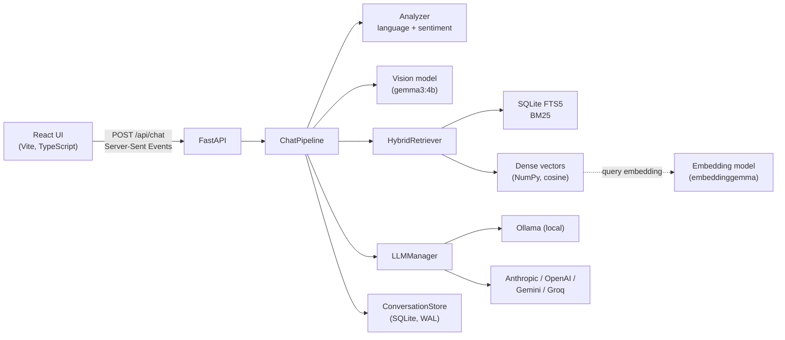

# Architecture

Billie is a retrieval-augmented generation (RAG) system with three corpora, a provider-neutral LLM layer and a streaming web UI. This document explains how a request flows through the system and why each design decision was made.

## System overview

| Corpus | Mode | Size | Source |
|---|---|---|---|
| `knowledge` | General | 4 help documents + user uploads | `knowledge/`, `data/uploads/docs/` |
| `medquad` | Medical | 27,582 passages / 16,407 QA pairs | MedQuAD (12 NIH websites) |
| `arxiv` | Research | 980,539 computer-science papers | Kaggle arXiv metadata snapshot |

## One chat turn

`ChatPipeline.run()` (`backend/src/billie/chat/pipeline.py`) is a generator of events, which the API streams as Server-Sent Events:

1. **Analyse** the message: language (script rules → romanised-Hindi detection → py3langid), sentiment (a linear probe on sentence embeddings), and **emergency screening** (deterministic patterns; a match shows a banner and adds a safety instruction to the prompt, independent of the model).
   - **Answer cache:** a first-turn, text-only question whose (mode, normalised text, model, corpus build, prompt hash) matches an earlier good answer is replayed in ~0.1 s, and every later step is skipped.
2. **Read images** if any are attached. A text-only chat model cannot see pixels, so the vision model writes a description and a `Search terms:` line. The terms drive retrieval, and the description becomes evidence in the prompt.
3. **Translate the search query** to English when the question is not in English, because the corpora are English. The answer is still requested in the user's language.
4. **Retrieve** with hybrid search (next section). Short or pronoun-heavy follow-ups ("what about its side effects?") are prefixed with the previous question.
5. **Generate.** The prompt contains numbered sources inside `<sources>` tags and the recent conversation. Tokens stream to the UI as they arrive.
6. **Verify citations.** `[n]` markers are parsed. Citing only real sources → *grounded*; citing a number that does not exist → *ungrounded*; citing nothing → *abstained*.
7. **Remember.** Both turns are written to SQLite with the sources and metadata, so a conversation can be reopened with its citation cards intact.

Each stage emits a `status` event (`reading_image`, `translating`, `retrieving`, `generating`), so a slow CPU-only machine still feels responsive.

## Retrieval

### Why SQLite FTS5 for BM25

FTS5 ships inside Python's `sqlite3`, ranks with BM25 on disk, and handles the 980k-paper arXiv corpus (a 2.6 GB index) in roughly 0.3–0.6 s per query without loading it into RAM. A pure-Python inverted index would need several GB of memory; Elasticsearch would add a server for little gain at this scale. Titles are weighted 2× (`bm25(passages_fts, 2.0, 1.0)`), so a MedQuAD question or paper title that matches outranks an incidental mention in a body.

### Dense retrieval

Passages are embedded with `embeddinggemma` (768 dimensions, multilingual) through Ollama and stored as an L2-normalised `float32` matrix. Cosine similarity is a single matrix-vector product. The model name is recorded in the index manifest, and the retriever refuses to mix vectors from a different model.

Embedding is the expensive step on a laptop CPU (~8 passages/s), so Billie embeds:
- **MedQuAD**: the first chunk of each answer, with its question as the title (16,407 vectors). That identifies what the answer is about, and BM25 still covers every chunk.
- **arXiv**: the 50,000 most recent papers (title + start of the abstract). BM25 covers all 980k.

`embed_index` writes checkpoints in parts of 512, so an interrupted run (Ctrl+C, power cut) resumes where it stopped.

### Fusion: Reciprocal Rank Fusion

`RRF(d) = Σ 1 / (60 + rank_r(d))` over the BM25 and dense rankings. RRF combines *ranks*, so BM25 scores (unbounded) and cosine similarities (−1 to 1) never have to be calibrated against each other. If the embedding model is down, the retriever degrades to BM25 and reports `degraded: true`; the request doesn't fail.

### Atomic index builds

`build_index` writes to `<name>.sqlite.building` and swaps it in with `os.replace`. A failed or interrupted build never corrupts the live index, and the strict `INSERT` (no `OR IGNORE`) means ID collisions fail loudly. That surfaced three real data problems: MedQuAD reuses question IDs within documents, reuses document IDs across its 12 subsets and across files, and the arXiv snapshot contains duplicate papers.

## LLM layer

`LLMProvider` (`backend/src/billie/llm/base.py`) is a five-method protocol: `stream`, `list_models`, `health`, `supports_vision`, plus `name`/`model`. There are three implementations:

| Provider | Transport | Notes |
|---|---|---|
| `OllamaProvider` | NDJSON over httpx | `think: false`, `keep_alive`, `repeat_penalty`; capabilities read from `/api/show` |
| `OpenAICompatibleProvider` | SSE over httpx | OpenAI, Groq, Gemini, OpenRouter, LM Studio, vLLM |
| `AnthropicProvider` | Official `anthropic` SDK | Defaults to `claude-opus-5-5` with server-side refusal fallback enabled |

`LLMManager` holds the active configuration, which can be changed at runtime from the UI. It persists to `data/llm_settings.json` with atomic writes, keeps one API key per provider, and only ever returns keys masked (`sk-a…f9c2`). A `strip_think` stream filter removes `<think>…</think>` blocks that some local reasoning models emit inline, including tags split across chunks.

### Latency on a CPU-only laptop

Measured on a Ryzen 7 5800HS with 16 GB RAM and no usable GPU:

| Model | Prompt processing | Generation |
|---|---|---|
| `qwen3:4b-instruct` | ~39 tok/s | ~10 tok/s |
| `qwen3:8b` | ~18 tok/s | ~5 tok/s |
| `llama3.2` (3B) | ~51 tok/s | ~12 tok/s |

Two measured fixes matter most: Ollama is addressed as `127.0.0.1` (on Windows `localhost` tries IPv6 first and cost ~2.3 s per new connection), and models are pre-loaded at startup. Together with the answer cache, a fresh medical answer went from ~43 s to ~25 s, and repeats take ~0.1 s.

Prompt processing dominates time-to-first-token, so the design budgets context carefully: 4–5 passages of at most 650 characters, the last 3 turns of history with answers clipped to 500 characters, and a **system prompt that is byte-identical across requests**, so the model server reuses its cached processing. Everything that varies (language, tone) goes in the final user message.

## Language and sentiment

- **Language**: deterministic. Script ranges identify Devanagari, Bengali, CJK and other scripts with near certainty. A cue-word check catches romanised Hindi, which statistical classifiers misread. py3langid handles Latin-script text, and very short inputs ("hi", "BM25?") default to English.
- **Sentiment**: a 3-class softmax head trained with NumPy on embeddings of `cardiffnlp/tweet_sentiment_multilingual` (8 languages). It reuses the retrieval embedding model, so it adds one ~30 ms embedding call and no new model download. A word list is the offline fallback. Results are in [`docs/evaluation/sentiment`](evaluation/sentiment).

## Security

| Threat | Mitigation |
|---|---|
| Open deployment | `BILLIE_ENV=production` refuses to start without `BILLIE_ADMIN_KEY`, and without `BILLIE_API_KEY` unless it is a public demo; keys are compared in constant time |
| Public demo abuse | `BILLIE_DEMO=1`: conversations are owned by a hashed per-browser visitor id (someone else's chat is a 404); daily question caps per visitor IP and in total protect the free model quota; cached answers are refunded; settings and documents stay admin-only |
| Arbitrary file read | The original API accepted server *paths* for images. Uploads are now validated by magic bytes and size, stored under random IDs, and referenced only by ID |
| Path traversal | IDs must match `^[0-9a-f]{32}\.(png\|jpg\|gif\|webp)$`; document names are reduced to a safe base name |
| Prompt injection via documents | Sources are fenced in `<sources>` and declared untrusted in the system prompt; fence tags inside third-party text are neutralised, so a document cannot close the block |
| SSRF | URL ingestion was removed; the knowledge base only takes local files and uploads |
| Abuse of expensive endpoints | Per-client token-bucket rate limit on chat, uploads and model tests |
| Browser hardening | CSP (`frame-ancestors` configurable for hosted demos), `X-Frame-Options: DENY`, `nosniff`, `no-referrer`; CORS limited to configured origins |
| Medical emergencies | Deterministic multilingual detector → banner with emergency numbers / crisis helplines, plus a prompt instruction; doesn't rely on the model |
| Runaway generation | Pure ASGI middleware, so a client disconnect (Stop button, closed tab) closes the stream to Ollama within ~0.1 s; a regression test forbids `BaseHTTPMiddleware` |

## Deployment

- **Local** (default): two processes (`uvicorn` + Vite dev server) or `docker compose up`, with Ollama models on the host.
- **Hosted demo** (`deploy/huggingface/`): one container serves the API and the built React app on port 7860. Answers come from Groq (text) and Gemini (images), with keys stored as host secrets. Ollama + `embeddinggemma` run *inside* the container for embeddings, because the indexes were embedded with that exact model; mixing embedding models would make the vectors incomparable.
- **Index bundle:** `python -m billie.ingest bundle` copies MedQuAD and only the 50k embedded arXiv papers. It remaps rowids to the vector order, cutting 2.6 GB to ~300 MB with identical hybrid results for those papers.
- **Hosting:** the live demo runs on **Azure Container Apps**: scale to zero, at most 1 replica, 2 vCPU / 4 GiB, keys as Azure secrets. The image is built by a manual GitHub Actions workflow, because Azure's image builder is disabled on student subscriptions, and pushed to Azure Container Registry. Hugging Face Docker Spaces now need a paid plan. The container needs ~2 GB RAM (embedding model + vectors), which rules out 512 MB free tiers unless embeddings move to an API.

## Testing

- **Backend (pytest)**: unit tests for BM25/RRF math, chunking, resumable embedding, the think-filter, providers (via `httpx.MockTransport`), the settings manager, uploads and language detection. Pipeline and API tests use a scripted fake LLM, so the full suite runs offline in about 10 s.
- **Frontend (Vitest + Testing Library)**: SSE parsing with chunk splits at arbitrary bytes and multi-byte characters, citation rendering, and the streaming chat hook against a mocked backend.
- **CI** runs ruff, `ruff format --check`, mypy, pytest with coverage, `tsc` and Vitest, then builds the frontend.

## Trade-offs and next steps

- **Middleware style.** Starlette's `@app.middleware("http")` (`BaseHTTPMiddleware`) relays streamed bodies through an internal pipe, which hid client disconnects: a stopped answer kept the CPU busy for 20–35 s. All middleware is pure ASGI instead. Found with a minimal reproduction after a passing unit test had given false confidence.
- **Single process.** The rate limiter and settings live in memory and on local disk, which suits a local-first app. A multi-instance deployment would move them to Redis and a secrets manager.
- **Dense coverage of arXiv** is limited to the newest 50k papers by CPU time. On a GPU machine, `python -m billie.ingest arxiv --embed-only --embed-limit 1000000` covers everything.
- **A cross-encoder reranker** over the top 20 RRF candidates is the next retrieval improvement. It is worth adding only if evaluation shows relevant passages are retrieved but ranked too low.
- **Citation verification** checks that citations refer to real sources, not that each sentence is entailed by its source. An NLI-based checker would close that gap.
